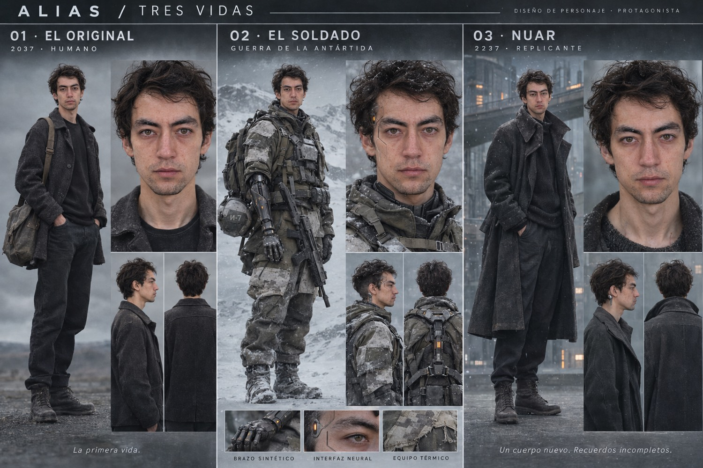
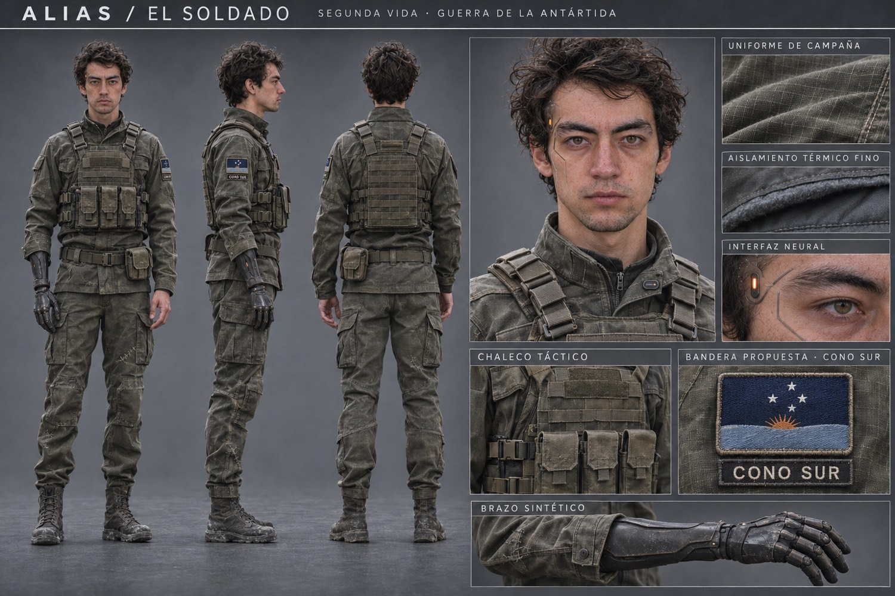
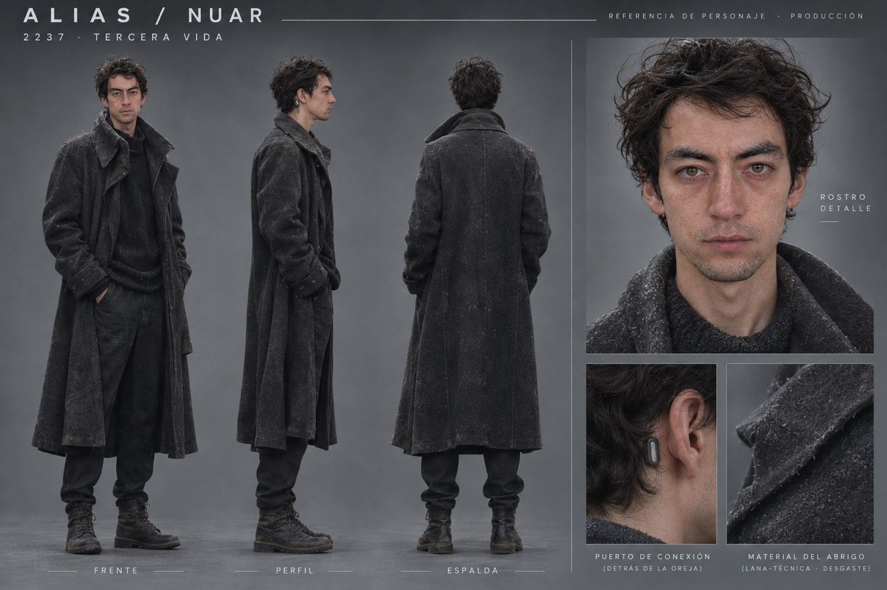
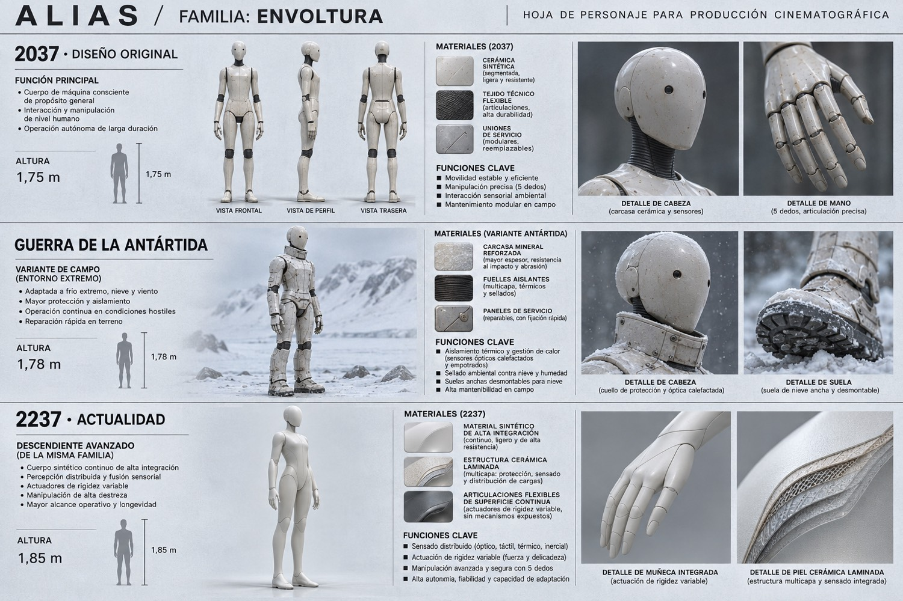
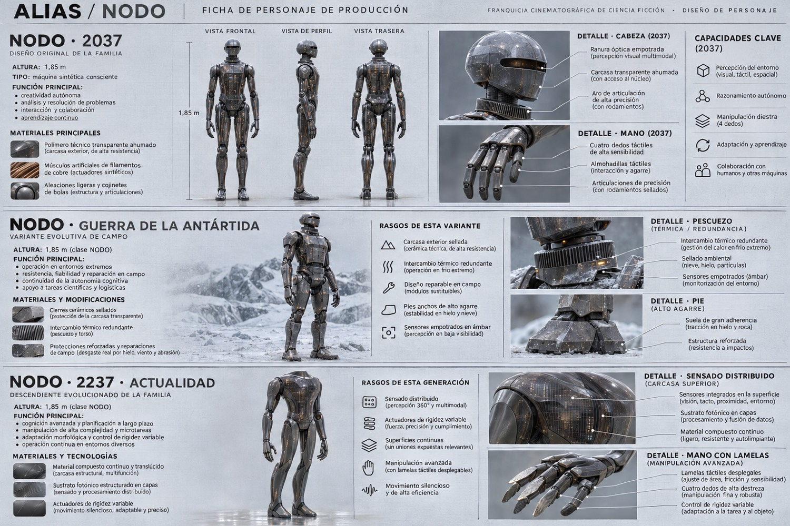
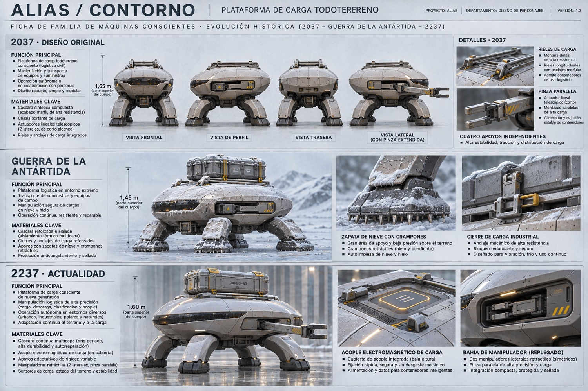
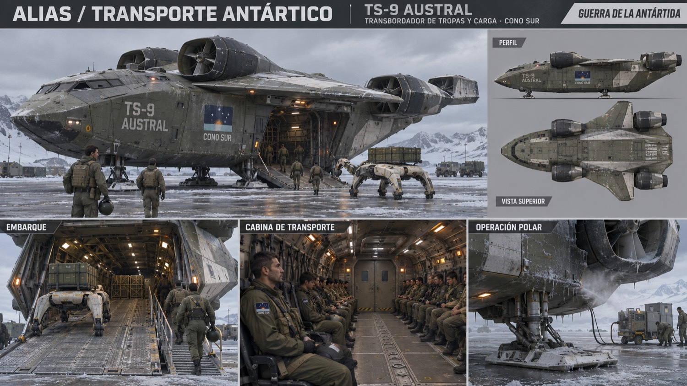
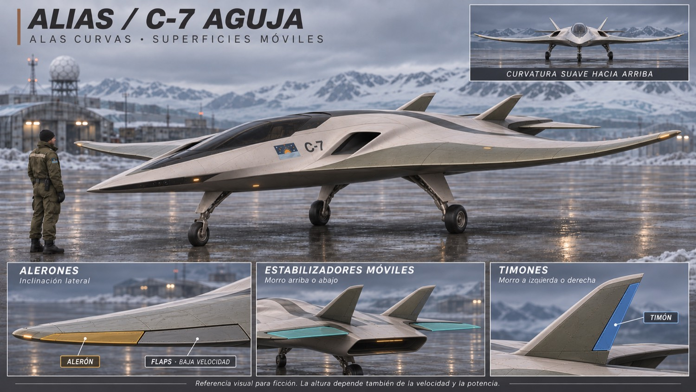
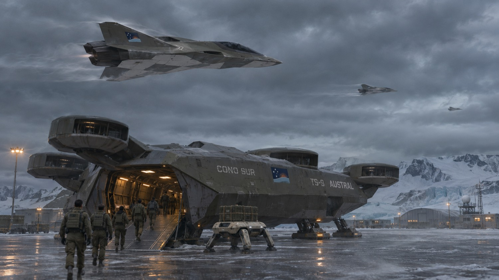

# ALIAS — Índice de arte conceptual

Imágenes generadas en esta conversación. Copias JPEG optimizadas; originales PNG conservados fuera del repositorio. Diseños de ficción, sin validación técnica.

## Tres vidas · referencia de identidad

Estado: ARTE CONCEPTUAL · AJUSTE DE EDAD PENDIENTE.

Original de sesión: `exec-5639548b-a231-409e-a88e-adfef7c2b56d.png`.

## El soldado del Cono Sur

Estado: DISEÑO SELECCIONADO.

Original de sesión: `exec-94e1e2c6-83d7-4845-b94d-260d9b434e92.png`.

## Nuar · tercera vida

Estado: REFERENCIA DE PERSONAJE.

Original de sesión: `exec-3909b2a1-a84a-48c0-9081-4166ca7eac29.png`.

## Máquinas · Envoltura

Estado: ARTE CONCEPTUAL.

Original de sesión: `exec-06a1bc6a-48a3-4609-a1cd-8f45b6a02ad7.png`.

## Máquinas · Nodo

Estado: ARTE CONCEPTUAL.

Original de sesión: `exec-ba7ed8fc-ae95-487f-a263-1394df428a85.png`.

## Máquinas · Contorno

Estado: DISEÑO CORREGIDO.

Original de sesión: `exec-0f0a39fc-29a3-4067-8882-c6bbaed85dbd.png`.

## TS-9 Austral

Estado: ARTE CONCEPTUAL.

Original de sesión: `exec-2cf7700e-aef3-428d-b065-692c036d097f.png`.

## C-7 Aguja · dirección vigente

Estado: ÚLTIMA ITERACIÓN VISUAL.

Original de sesión: `exec-f556e27e-8f38-4f3a-8964-a0b82e030b86.png`.

## Embarque · atmósfera

Estado: REFERENCIA DE ESCENA.

Original de sesión: `exec-a47aabe2-df20-4fdb-b9cf-fdd79745ef3b.png`.

