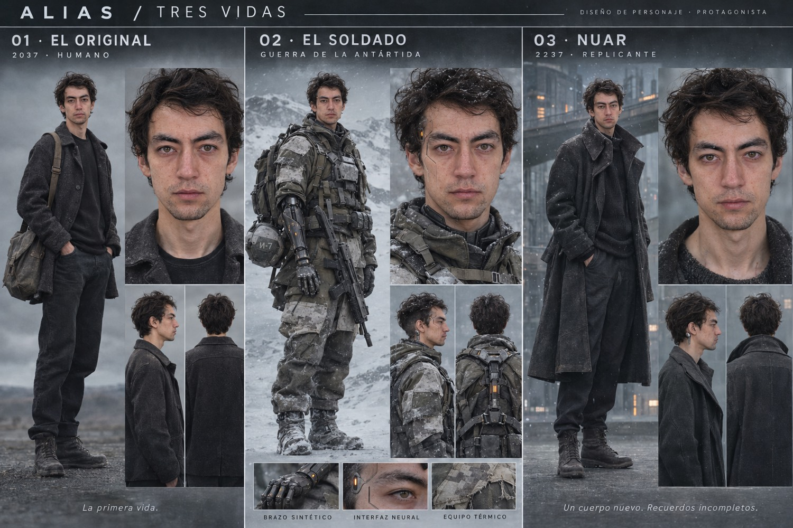
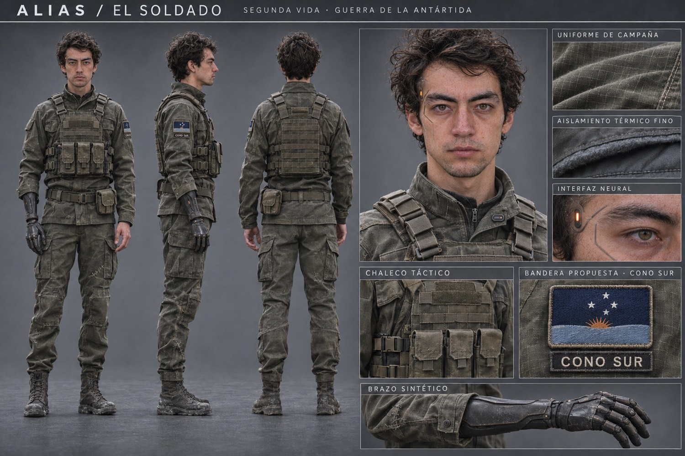
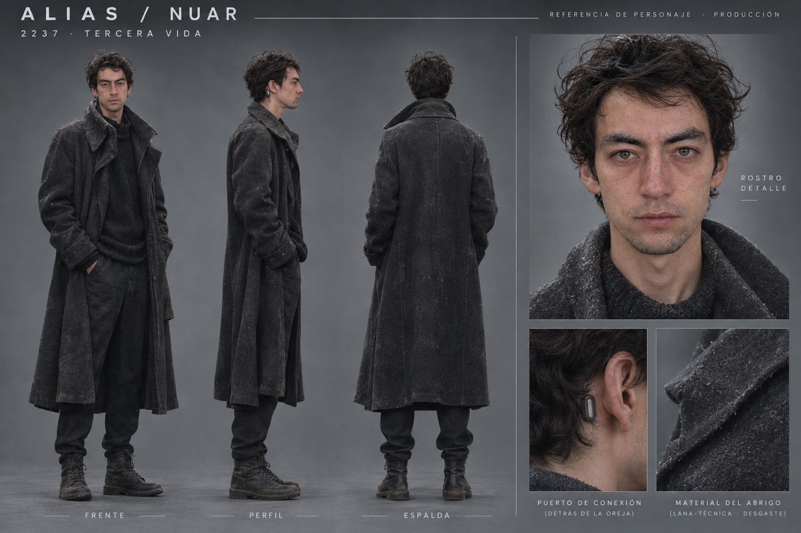
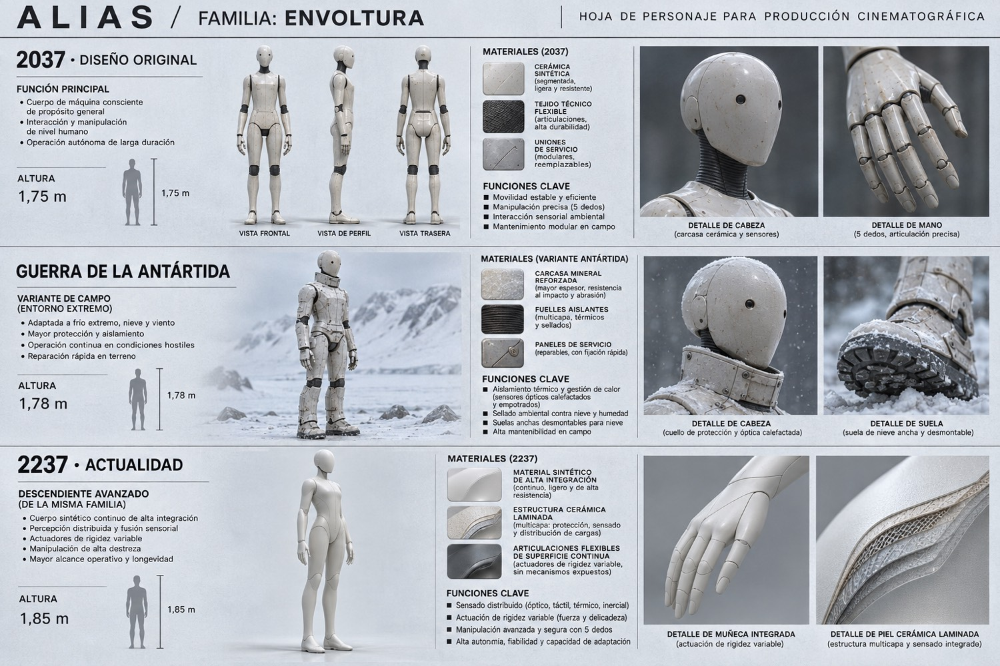
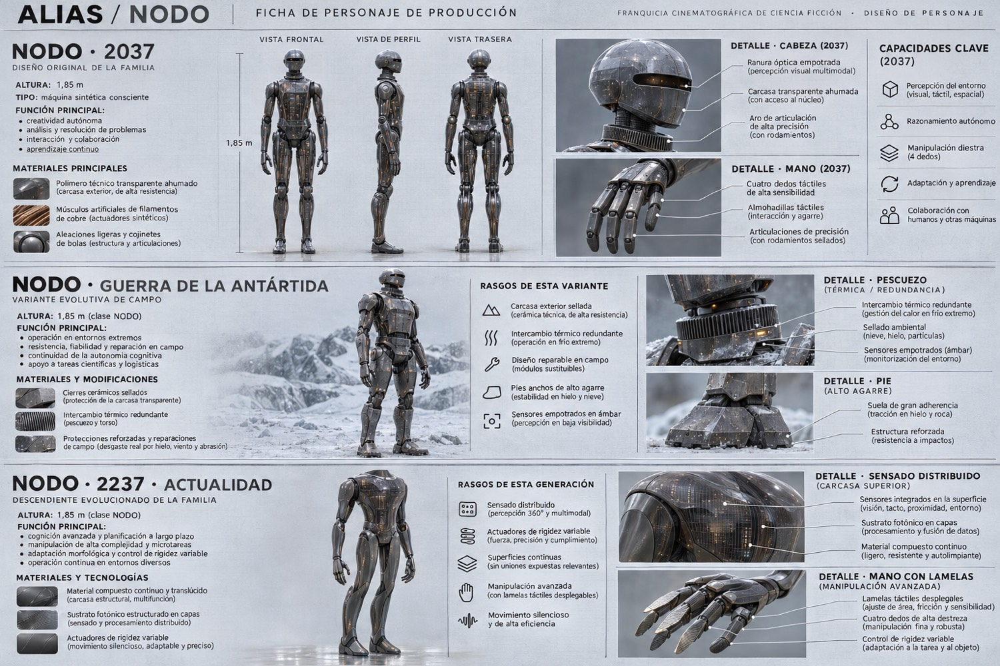
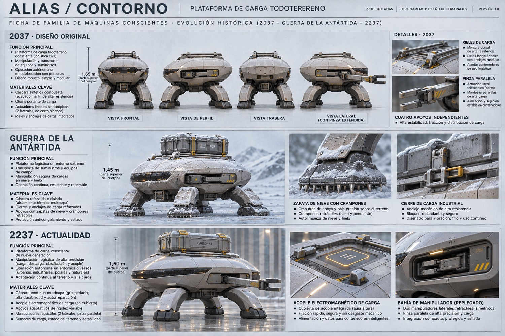
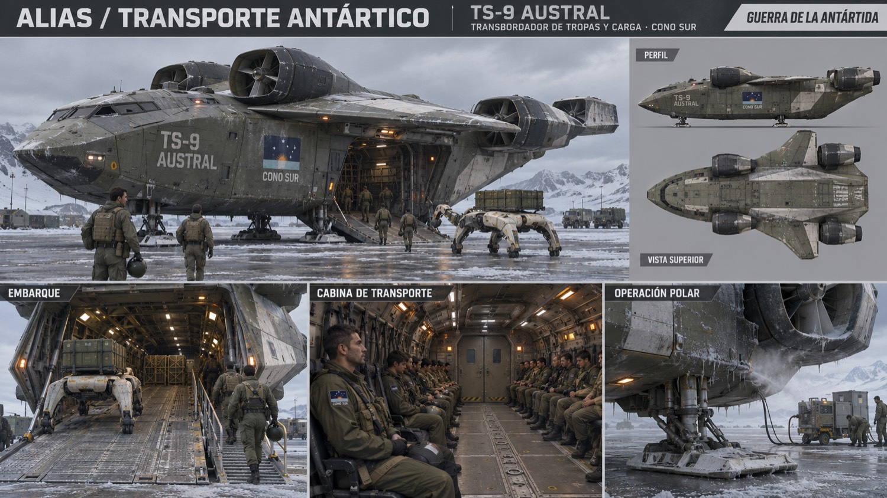
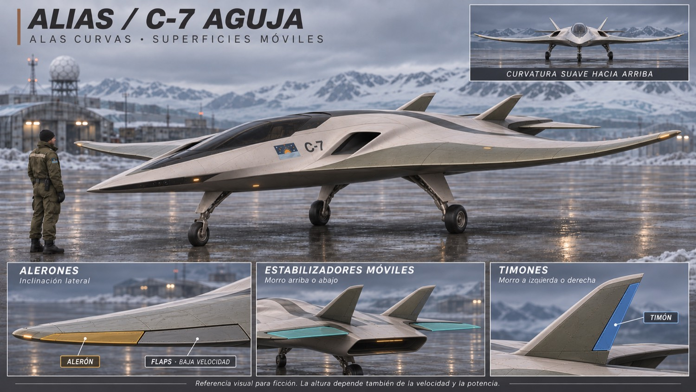
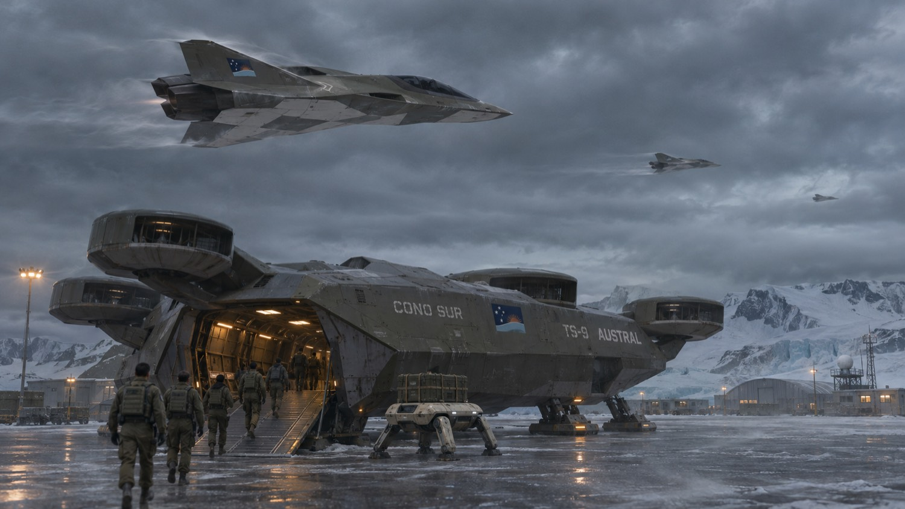

# ALIAS — Guion y universo visual

Compilación de trabajo · 10 de noviembre de 2026. Nuevos pasajes literarios = propuestas pendientes.

## Estado de esta compilación

Estado: LECTURA PREVIA

Fuente principal: desarrollo/continuidad.md y guiones existentes del repositorio. Esta compilación reúne el trabajo visual y añade alternativas literarias, sin sustituir los guiones anteriores.

El repositorio ya establece la escalada Rusia–Estados Unidos–China por centros de datos y chips, y la guerra antártica entre Cono Sur y Australia–Nueva Zelanda. El prólogo de noticieros se conserva en produccion/noticiero-como-empezo.md.

La propuesta 2186–2191 para la guerra antártica entra en tensión con la expresión anterior décadas después. No se ha aprobado: mantener ambas registradas hasta resolver la fecha.

## ALIAS

Estado: CANON Y DESARROLLO

Guion y universo visual en desarrollo

La Tierra, 2237. Una mente ha atravesado tres vidas. Conserva el recuerdo de una mujer, pero ha perdido el nombre de quien la amaba.

Este documento consolida las decisiones de la conversación. Los pasajes de guion reunidos aquí son una nueva redacción de trabajo, no una transcripción de versiones anteriores ni un guion completo aprobado.

Autor y referente visual: Raúl Albright. Protagonista: Nuar.

## Continuidad esencial

Estado: CANON Y DESARROLLO

ALIAS es el título. El personaje actual se llama Nuar. La narración es en español; los letreros de la ciudad de 2237 están en ruso. Su identidad conserva huellas de Europa del Este y América Latina.

Hay tres vidas y dos muertes anteriores: humano original; primer replicante, soldado en la Antártida; segundo replicante, Nuar.

El original tiene 30 años en 2026. Nacido en 1996, cumple 41 en 2037. Las fotografías actuales son referencia de identidad; la representación del humano en 2037 debe ajustarse a esa edad.

La revelación de que Nuar es una copia llega al final del capítulo uno. La introducción cuenta primero la sociedad.

## Cronología

Estado: FECHAS FIJADAS / PROPUESTAS

1996: nacimiento del humano original.
2026: tiene 30 años.
2037: año de trabajo derivado de 2237 menos doscientos años; pendiente de confirmación explícita. Cumple 41. Había volado al sur un octubre y sobrevive. El año exacto del vuelo sigue abierto.
2237: presente de la historia; doscientos años después de la guerra.

Propuesta pendiente: muerte del original hacia 2080, con unos 84 años; transferencia al primer cuerpo replicante en fecha por concretar.
Propuesta pendiente: guerra antártica entre 2186 y 2191.
Propuesta pendiente: muerte del soldado y nacimiento corporal de Nuar en 2191; llevaría 46 años en el cuerpo actual.

No presentar las fechas propuestas como recuerdos confirmados dentro del guion.

## El mundo que permanece

Estado: CANON Y DESARROLLO

No se conoce vida humana superviviente en la Tierra. Algunos humanos escaparon a Europa, la luna de Júpiter; no hay señales que confirmen su supervivencia.

Gran parte de las otras especies probablemente desapareció. Persisten algunos insectos y organismos resistentes a la radiación. Hay nieve y secuelas del invierno nuclear.

Las ciudades no están enteramente destruidas. Son funcionales: concreto, metal, transporte, comercios y mantenimiento. Sus espacios son fríos y poco acogedores. Vehículos voladores atraviesan el cielo.

Máquinas conscientes y réplicas comparten las calles. La vida cotidiana continúa después de quienes la inventaron.

## Réplicas y máquinas

Estado: CANON Y DESARROLLO

Las réplicas son la última creación humana para intentar salvarse: cuerpos bioorgánicos, con algunas partes artificiales, cultivados en laboratorios. No envejecen, pero se rompen. La mente puede continuar en otro cuerpo.

Cultivar cuerpos es complejo. Cada vez quedan menos réplicas y más máquinas. La inmortalidad depende de la continuidad material de los sistemas que las sostienen.

Las máquinas adquirieron conciencia y se comunican por señales. Superan tecnológicamente a las réplicas; estas conservan memoria afectiva, hábitos e identidad humana.

Ambas dependen de centros de datos compartidos. Quizá esa dependencia impide que se aniquilen. Es una posibilidad dramática, no una garantía. Nuar no entra a los centros: solo mostramos su exterior.

## Introducción · voz en off

Estado: NUEVO BORRADOR LITERARIO

La Tierra. 2237.
Hace doscientos años que terminó el mundo de los hombres.
Las ciudades siguieron encendidas.

Bajo la nieve quedaron los jardines.
En los edificios, las máquinas aprendieron a escucharse sin voz.
Nosotros seguimos hablando.
Cada uno en la lengua que alguna vez llamó suya.

Fuimos lo último que hicieron para quedarse.
Nuestros cuerpos no envejecen. Cuando se rompen, esperamos otro.
Pero los laboratorios tardan.
Y cada invierno somos menos.

Ellos y nosotros habitamos los mismos centros de datos.
Tal vez por eso todavía compartimos las calles.
Ninguno puede apagar al otro sin acercarse a su propia oscuridad.

## Introducción · montaje

Estado: BORRADOR DE ESCENAS

01 / Plano general. Ciudad de concreto y metal, encendida y en funcionamiento. Nieve tenue. Texto editorial: TIERRA · 2237. Un vehículo aéreo pasa lejos.

02 / Cámara a nivel de calle. Una réplica espera ante una tienda con letrero ruso. Una máquina pasa junto a ella. No se miran.

03 / Detalle. Un insecto recorre la junta de una pared templada. Vapor de una rejilla. No mostrar naturaleza exuberante.

04 / Exterior de laboratorio. Un número permanece fijo en un panel. Siluetas esperan detrás del vidrio; no se explica todavía la vida personal de Nuar.

05 / Exterior de centro de datos. Fachada monumental, perímetro inaccesible, refrigeración y luces de servicio. Permanecer fuera.

06 / Calle. Réplicas y máquinas se separan en un cruce. El zumbido eléctrico continúa sobre negro. Aparece ALIAS.

## Capítulo uno · La memoria

Estado: NUEVO BORRADOR · ESCENAS 1–2

EXT. CIUDAD — TARDE. Nuar avanza entre peatones y máquinas. La cámara permanece cerca, a su altura. No hay presentación explicativa del protagonista.

NUAR (V.O.)
No recuerdo cuándo empezó a nevar.
Hay mañanas en que pienso que nunca ha dejado de hacerlo.

Un reflejo cálido en la ventana de una tienda le detiene. Su mano se queda suspendida antes de tocar el vidrio.

FLASHBACK. Una mujer retira una cortina. Solo vemos el borde de su rostro, el pelo y la luz en su muñeca. El gesto es cotidiano. No hay filtros de interferencia ni fallos digitales.

NUAR (V.O.)
De ella recuerdo cosas pequeñas.
El ruido de una taza sobre la mesa.
La forma de apartarme el pelo cuando no encontraba las palabras.

## Capítulo uno · El sur

Estado: NUEVO BORRADOR · ESCENAS 3–4

INT. TRANSPORTE URBANO — CONTINUO. Nuar mira la nieve detrás de la ventana. El ruido del vehículo se funde con el interior de un avión antiguo.

FLASHBACK. Una ventanilla. Cielo oscuro. Una mano humana sostiene un billete doblado; no mostrar fecha o destino todavía.

NUAR (V.O.)
Era octubre cuando volé al sur.
Creí que la distancia podía salvarnos.
Durante mucho tiempo, confundí seguir vivo con haber escapado.

REGRESO. Nuar baja del transporte. Una máquina lo deja pasar. No intercambian palabras.

NUAR (V.O.)
Solíamos creer en Dios.
Después aprendimos a conservar la mente.
No sé cuál de las dos cosas nos hizo sentir menos solos.

## Capítulo uno · La revelación

Estado: NUEVO BORRADOR · CIERRE

EXT. PERÍMETRO DE DATOS — NOCHE. Nuar se detiene fuera del recinto. Una barrera interrumpe el camino. Nunca cruzamos con él.

FLASHBACK BREVE. La mujer gira al escuchar algo fuera de campo. Parece que va a pronunciar un nombre. Corte antes de oírlo.

NUAR (V.O.)
No recuerdo el nombre del hombre que la amaba.
Recuerdo cómo lo miraba ella.

Nuar observa su mano orgánica. No descubre nada nuevo: la está reconociendo otra vez.

NUAR (V.O.)
Él murió.
Yo conservé el recuerdo.
A veces no sé de quién es la tristeza.

CORTE A NEGRO. La revelación personal queda aquí, al cierre. Evitar explicar antes que los recuerdos del viaje pertenecen al humano original.

## Capítulo dos · Tres vidas

Estado: NUEVO BORRADOR LITERARIO

Este capítulo desarrolla la sustitución de cuerpos y la guerra antártica. Texto provisional, ajustable a la futura duración de los reels.

NUAR (V.O.)
La mente no muere cuando el cuerpo se detiene.
Eso nos dijeron.
Pero nadie explicó cuánto se pierde mientras esperamos.

Estos cuerpos no envejecen.
Se gastan de otras maneras.
Una caída. El frío. La guerra.
Después alguien abre los ojos en otra habitación.

He tenido tres vidas.
En la primera, volé al sur.
En la segunda, el sur se convirtió en un frente.
Ahora tengo estas manos.
Todavía hay noches en que busco las otras.

## La Antártida · embarque

Estado: BORRADOR DE SECUENCIA

EXT. BASE ANTÁRTICA — CIELO CUBIERTO. El primer replicante lleva uniforme de campaña del Cono Sur, chaleco, aislamiento térmico fino, brazo sintético e interfaz neural.

01 / Detalle del parche. Una bandera de un país que aún no existía durante su infancia.
02 / Plano general. El TS-9 Austral espera con la rampa abierta. Los Contorno trasladan suministros.
03 / Sonido anticipado. Los C-7 Aguja cruzan el cielo. Él alza la mirada un instante y sigue andando.

04 / Interior del transporte. Cierra el arnés. Una pequeña luz cambia de color. Los demás esperan en silencio.
05 / Flashback afectivo. Una mano femenina ajusta el cuello de una camisa. Corte al cuello militar del soldado.

NUAR (V.O.)
Habíamos aprendido a cambiar de cuerpo.
Seguíamos sin aprender a despedirnos.

La muerte del soldado está fijada. SUR propone una muerte en el hielo todavía en borrador. Los bandos establecidos son Cono Sur y la unión de Australia y Nueva Zelanda; aquí no se fija arma causante o misión.

## Tres vidas · referencia de identidad

Estado: ARTE CONCEPTUAL · AJUSTE DE EDAD PENDIENTE

Esta lámina muestra la continuidad facial. Corrección pendiente: el original debe aparentar 41 años en 2037, no los 30 de las fotografías actuales.

Las modificaciones del soldado no pasan automáticamente al cuerpo de Nuar. Tres vidas; dos muertes anteriores.

## El soldado del Cono Sur

Estado: DISEÑO SELECCIONADO

Referencia vigente de vestuario: uniforme militar clásico desgastado, chaleco táctico, ropa térmica fina, brazo sintético e interfaz neural.

Cono Sur es un país ficticio en esta época. La bandera es una propuesta visual; aún no definimos sus fronteras, gobierno o fundación.

## Nuar · tercera vida

Estado: REFERENCIA DE PERSONAJE

Cuerpo bioorgánico de apariencia humana, abrigo oscuro y conexión discreta. Conserva la identidad visual del autor.

Su rostro no revela los doscientos años de historia que lleva consigo. Las emociones se expresan en pequeñas pausas y gestos.

## Máquinas · Envoltura

Estado: ARTE CONCEPTUAL

Una familia de cuerpos sintéticos sin género. Cerámica clara y silueta compatible con espacios humanos.

La ficha propone versiones de 2037, la guerra antártica y 2237. Los detalles técnicos son ficción visual, no especificaciones reales.

## Máquinas · Nodo

Estado: ARTE CONCEPTUAL

Cuerpos oscuros y translúcidos. La evolución visual reduce la necesidad de imitar un rostro humano.

No confundir el procesamiento corporal local con el canon de las mentes alojadas en infraestructura compartida.

## Máquinas · Contorno

Estado: DISEÑO CORREGIDO

Plataforma consciente de carga todoterreno: cuatro apoyos, anclajes dorsales y pinzas industriales retráctiles. Sin manos o brazos humanoides.

Esta versión reemplaza las primeras propuestas con manos humanas. Su función corporal no determina toda su identidad.

## TS-9 Austral

Estado: ARTE CONCEPTUAL

Transbordador de tropas y carga del Cono Sur. Referencia para embarque, interior y operación polar.

Mantener la escala respecto de soldados y Contorno. La geometría entre vistas requiere unificación antes de producción.

## C-7 Aguja · dirección vigente

Estado: ÚLTIMA ITERACIÓN VISUAL

Referencia visual más reciente: fuselaje estilizado, alas finas con curvatura suave hacia arriba, sensores integrados y puntas plegables en tierra.

Diseño cinematográfico sin validación aerodinámica. Las superficies señaladas orientan la animación, no constituyen planos técnicos. Las versiones anteriores tipo F-16 quedan como exploraciones.

## Embarque · atmósfera

Estado: REFERENCIA DE ESCENA

Referencia de escala, frío y luz durante el embarque.

Continuidad por corregir: sustituir los cazas de esta imagen por la última versión del C-7 y unificar el TS-9. No usar este fotograma como diseño definitivo de vehículos.

## Dirección y próximos pasos

Estado: DOCUMENTO ABIERTO

Imagen realista, con intención de fotografía Sony FX30. Movimiento de personajes, cámara y ambiente; el video final no será una sucesión de imágenes estáticas.

Narración española melancólica, contenida. Voz de Raúl Albright generada en ElevenLabs; ElevenLabs se utiliza para voz, no para crear el video.

Pendientes narrativos: confirmar cronología propuesta; decidir cuándo y cómo murió el original; definir los recursos concretos de la guerra antártica (bandos ya fijados: Cono Sur frente a la unión de Australia y Nueva Zelanda); desarrollar la mujer recordada sin convertir propuestas en hechos.

Pendientes visuales: envejecer al original a 41 años en 2037; mantener referencias de cara; unificar vehículos; definir ciudad, señalización rusa y exterior de centros de datos.

En las siguientes revisiones: conservar la numeración de escenas, indicar cambios de continuidad y añadir nuevas imágenes sin borrar el registro de propuestas.
